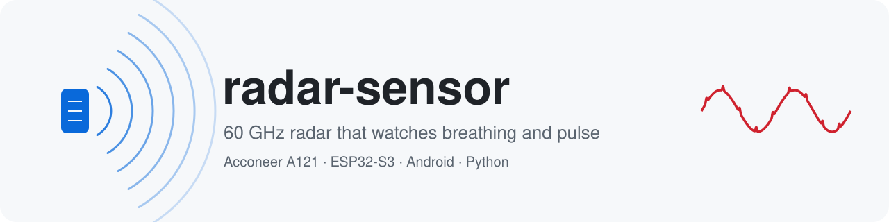
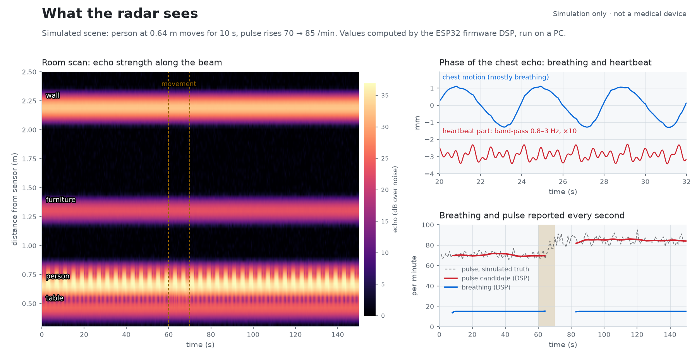
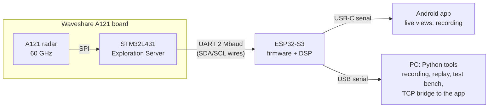

<p align="center">
  
</p>

<p align="center">
  <a href="https://github.com/juvenile454/radar-sensor/actions/workflows/tests.yml"></a>
  <a href="LICENSE"></a>
  
  
  
  
  
</p>

A hobby and learning project. It reads a **60 GHz pulsed coherent radar** (Acconeer A121) with an **ESP32-S3**,
computes **breathing, a pulse candidate and a room scan** on the microcontroller, and shows everything live in an
**Android app** over USB-C. Python tools on the PC record, replay and test it.

The radar sees the chest move by fractions of a millimeter, without contact. Breathing moves it by millimeters;
the heartbeat by about 0.1–0.5 mm. Getting that pulse out reliably is the hard part, and this repo documents the
attempts honestly: what works on the device, what only works in simulation, and what is still open.

<picture>
  <source media="(prefers-color-scheme: dark)" srcset="docs/img/hero-dark.png">
  
</picture>

<sub>The picture is a <b>simulation</b> (<code>host/vital_sim.py</code>, scenario <code>beweg_hr</code>), not a
measurement of a real person. The values come from the real firmware DSP, compiled for the PC.
Rebuild it with <code>docs/img/make_figures.py</code>.</sub>

> [!IMPORTANT]
> **Not a medical device.** Pulse values are *rhythm candidates* in the radar signal. Without a reference measurement
> (chest strap, ECG) this project makes no claims about pulse accuracy. A chest-strap comparison is the next step.

## Highlights

- **Full raw radar data over two wires.** The A121 board runs Acconeer's *Exploration Server*, rebuilt from the
  official SDK so that its UART sits on the board's SDA/SCL pins. The ESP32-S3 gets sparse IQ with up to 4 subsweeps,
  loopback and every profile, at 2 Mbaud (≈ 195 kB/s net).
- **Three measurements at once, 60 frames per second.** On-chip loopback (phase reference), a 2.5 mm vital zoom on
  the chest (24 points) and a room scan from 0.30 to 2.67 m (80 × 30 mm).
- **One DSP, three places.** The same C++ header runs on the ESP32-S3, in the PC replay and in the Android app
  (NDK). Replaying a device recording on the PC reproduces the firmware's reports line for line, and the phone matches
  the PC bit for bit.
- **Test bench instead of guesswork.** 20+ synthetic scenarios (movement, breath holding, a person leaving,
  harmonics, tapping…) run through the real firmware code. Limits fail the build when a change makes things worse.
- **Android app that keeps recording.** Live views, console and recording in the background: 31.7 min with the screen
  off and no lost frames. It reconnects after unplugging and can recompute raw data on the phone.

## Status

✅ verified on the device · 🧪 PC or simulation only · ⏳ open

| Part | Status | Notes |
|---|---|---|
| Exploration Server on LPUART1 (STM32) | ✅ | Built from SDK v1.13.0; restarts itself after UART errors |
| ESP32-S3 ↔ server link, `iq3` 3-subsweep session | ✅ | ~58 Hz, mobile on battery wire too ([HARDWARE](docs/HARDWARE.md)) |
| Breathing rate and room scan on the ESP32 | ✅ | Run on the device (firmware `2026-11-02-vital1`); breathing check against a metronome is planned |
| Pulse candidate on the ESP32 | 🧪 | Runs on the device; accuracy unknown until the chest-strap comparison |
| Pulse reacquisition after movement (V6, switch `A121_DSP_REACQ`) | 🧪 | Off by default; better on the bench, worse on one real replay ([EXPERIMENTS](docs/EXPERIMENTS.md)) |
| Android app over USB | ✅ | Live views, background recording, reconnect ([ANDROID_APP](docs/ANDROID_APP.md)) |
| Comparison against a chest strap (Polar H9) | ⏳ | Strap recorded by the app alongside the radar (10 min test OK); comparison recordings planned |
| Bluetooth LE transport | ⏳ | Not started |

## How it works



Per frame the ESP32 receives loopback, zoom and room data. Once per second it reports `@VITAL`, `@DSP`, `@ROOM` and
`@STATE` lines (breathing rate, pulse candidate, confidence, motion, targets); the app and the PC tools parse them.
The full chain is described in [docs/HARDWARE.md](docs/HARDWARE.md) (command `iq3`) and at the top of
[`a121_esp_dsp.h`](firmware/esp32s3/src/a121_esp_dsp.h).

## Hardware

| Part | Notes |
|---|---|
| [Waveshare A121 Range Sensor Box](https://www.waveshare.com/) | Acconeer A121 + STM32L431, electrically like the XM125; comes with lenses |
| ESP32-S3-DevKitC-1 (WROOM-1 N16R8) | 16 MB flash, 8 MB PSRAM |
| MX1.25 10-pin cable | Board ↔ ESP32; pinout and wiring in [docs/HARDWARE.md](docs/HARDWARE.md) |
| Android phone with USB host | Developed on a Galaxy S26 Ultra |

## Getting started

**PC tools and tests** (Linux, Python 3.12, `g++`):

```bash
uv venv --python 3.12 .venv && uv pip install --python .venv/bin/python -r host/requirements.txt
.venv/bin/python -m unittest discover -s host/tests
.venv/bin/python host/vital_sim.py bench --check
```

**ESP32-S3 firmware** ([PlatformIO](https://platformio.org/)):

```bash
pio run -d firmware/esp32s3
```

Before uploading, identify the board and port (`ls -l /dev/serial/by-id`), then `pio run -d firmware/esp32s3 -t upload`.

**STM32 Exploration Server:** needs the Acconeer XM125 SDK, which is not part of this repo (license).
See [firmware/stm32l431/README.md](firmware/stm32l431/README.md) for download, build and flashing.

**Android app:**

```bash
cd android && ./gradlew :app:testDebugUnitTest :app:assembleDebug
```

Optional: set `radar.bridge=<host>:<port>` in `android/local.properties` to prefill the TCP bridge address.

## Repository layout

| Folder | Contents |
|---|---|
| `firmware/esp32s3/` | PlatformIO project: console, server client, `iq3`/`doppler`/`sess`, on-device DSP (`a121_esp_dsp.h`) |
| `firmware/stm32l431/` | Build script and notes for the Exploration Server on LPUART1 (SDK not included) |
| `android/` | Android app (Kotlin, Jetpack Compose, NDK for the phone DSP) |
| `host/` | Python: `a121_esp_ultimate.py` (iq3 recording, verify-cpp, plot, replay-cpp), `vital_eval.py` (evaluation against strap, metronome, markers), `vital_sim.py` (synthetic test bench), `reacq_eval.py`, `esp_record.py`, `esp_tcp_bridge.py`, `rezoom_check.py`, `noise_floor.py`, `a121_zielmessung.py`; `dsp_replay/` (C++ replay for PC and app), `fw_stub/` (compile the firmware on the PC), `tests/`. Archive (V5.3, older DSP chains, not maintained): `a121_ultimate_vital`, `a121_vitalaufnahme`, `a121_anhalteanalyse`, `a121_livemonitor`, `a121_esp_vital`, `a121_esp_auto` |
| `docs/` | Documentation (below); `docs/img/` README images; `docs/design/` design notes and implementation plans |

Recordings and datasets are not stored in the repo.

## Documentation

| Document | What's inside |
|---|---|
| [CONCEPT](docs/CONCEPT.md) | Goals, reality check, architecture, phases |
| [HARDWARE](docs/HARDWARE.md) | Boards, pinouts, wiring, power, firmware commands, device test logs |
| [EXPERIMENTS](docs/EXPERIMENTS.md) | Capability matrix, measurement plan, results |
| [VITAL_AUDIT](docs/VITAL_AUDIT.md) | Audit of the vital-sign detection: findings, test bench, plan V0–V6 |
| [ANDROID_APP](docs/ANDROID_APP.md) | App decisions, phases A0–A5, usage |

[`AGENTS.md`](AGENTS.md) holds the working rules for coding agents used in this project.

> [!NOTE]
> The code comments and docs are in English. Some program output, app labels and identifiers are still German
> (for example `@STATE` values like `GÜLTIG`, scenario names like `beweg_hr`).

## License

Own code: [MIT](LICENSE). The Acconeer SDK, Acconeer and Waveshare firmware and their demos are not part of this
repo and are covered by their vendors' licenses; the scripts neither download nor contain them.
